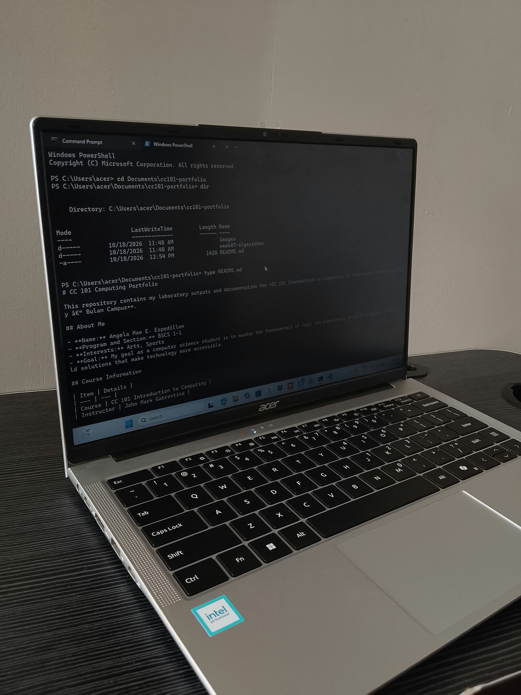

# CC 101 Computing Portfolio
 
This repository contains my laboratory outputs and documentation for *CC 101 Introduction to Computing* at **Sorsogon State University – Bulan Campus**.
 
## About Me
 
- **Name:** Angela Mae E. Espedillon
- **Program and Section:** BSCS 1-1
- **Interests:** Arts, Sports
- **Goal:** My goal as a computer science student is to master the fundamentals of logic and programming to build efficient, real-world solutions that make technology more accessible.
 
## Course Information
 
| Item | Details |
| --- | --- |
| Course | CC 101 Introduction to Computing |
| Instructor | John Mark Gabrentina |
| Academic Year | 2026–2027 |
 
## Portfolio Contents
 
1. [Week 7 – Pseudocode and Flowcharts](week07-algorithms/)
2. More activities will be added each week.
 
## Sample Pseudocode: Decimal to Binary
 
```
START DecimalToBinary

  DISPLAY "Enter decimal number: "
  INPUT decimalNum

  SET binaryStr = ""

  IF decimalNum == 0 THEN
      SET binaryStr = "0"
  ELSE
      WHILE decimalNum > 0 DO
          SET remainder = decimalNum MOD 2
          SET binaryStr = remainder + binaryStr
          SET decimalNum = decimalNum DIV 2
      END WHILE
  END IF

  DISPLAY "Binary equivalent is: ", binaryStr

END DecimalToBinary
```
 
## My Workspace
 

 
---

 
*Last updated: 2026-10-18*